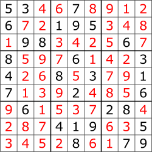

# Project One Million Sudoku Game - Kaggle Dataset

### Project overview

> An end-to-end Data Engineering and Machine Learning project leveraging Databricks, Apache Spark, PySpark, and MLflow to process and analyze a dataset containing one million Sudoku puzzles.

>The project aims to build a scalable data pipeline using the Medallion Architecture (Bronze, Silver, and Gold), perform exploratory data analysis (EDA), engineer relevant features, and develop Machine Learning models to predict Sudoku puzzle complexity.

>The workflow incorporates Cookiecutter for standardized project organization, Delta Lake for reliable data management, Spark MLlib for model development, and MLflow for experiment tracking and model evaluation.

>By integrating GitHub with Databricks, the project also explores reproducibility, version control, and MLOps best practices, demonstrating a complete workflow from raw data ingestion to predictive modeling.

<p align="center">
  
</p>

### Status & improvements

In progress

- [x] **Project Setup:** Organize the repository using Cookiecutter and configure the development environment.
- [x] **GitHub & Databricks Integration:** Connect the GitHub repository to Databricks Free Edition.
- [x] **Data Ingestion:** Import the Kaggle dataset using PySpark and create the Bronze layer.
- [x] **Data Cleaning & Validation:** Perform structural and mathematical Sudoku validation and create the Silver layer.
- [x] **Exploratory Data Analysis (EDA):** Analyze Sudoku patterns, distributions, and dataset characteristics.
- [x] **Feature Engineering:** Extract relevant puzzle features and create the Gold layer.
- [x] **Target Generation:** Develop and evaluate a Sudoku solver using increasingly advanced solving techniques to generate meaningful complexity metrics and difficulty labels for supervised learning.
- [ ] **Regression Modeling:** Train and compare regression models to predict Sudoku solving complexity using Spark MLlib.
- [ ] **Classification Modeling:** Train and compare classification models to predict Sudoku difficulty levels (Easy, Medium, Hard) using Spark MLlib.
- [ ] **Regression Evaluation:** Evaluate models using MAE, RMSE, and R².
- [ ] **Classification Evaluation:** Evaluate models using Accuracy, Precision, Recall, F1-score, and Confusion Matrix.
- [ ] **Model Comparison & Selection:** Compare model performance and select the best approaches for regression and classification.
- [ ] **MLOps & Experiment Tracking:** Track experiments, metrics, parameters, and model artifacts using MLflow.
- [ ] **Pipeline Automation:** Configure and execute workflows using Databricks Jobs, subject to Free Edition limitations.

### 🥉 Bronze Layer - Data Ingestion 

>Ingested 1,000,000 Sudoku puzzles from the Kaggle dataset using PySpark and Databricks. The raw CSV file was uploaded to a Unity Catalog Volume and processed into a Delta Lake table (`workspace.sudoku_bronze.raw_games`), preserving the original puzzle and solution data while adding ingestion timestamps and source file metadata for traceability.

### 🥈 Silver Layer - Data Cleaning & Validation

>The dataset contains 1,000,000 Sudoku puzzles. All records passed structural, consistency, duplicate, and mathematical solution validation checks (`workspace.sudoku_silver.validated_games`).

>For the complete validation methodology and results, see [Data Quality Documentation](docs/data-quality.md).

### 🥇 Gold Layer - EDA & Feature Engineering

>The Gold Layer has been successfully implemented using PySpark and Delta Lake.

- Processed 1,000,000 validated Sudoku puzzles.
- Engineered 7 numerical features describing puzzle structure and candidate availability:

| Feature | Description |
|---|---|
| `given_cells` | Number of initially filled cells in the Sudoku puzzle. |
| `row_clue_std` | Population standard deviation of clue counts across the nine rows. |
| `column_clue_std` | Population standard deviation of clue counts across the nine columns. |
| `box_clue_std` | Population standard deviation of clue counts across the nine 3x3 boxes. |
| `avg_candidate_count` | Average number of valid candidates per empty cell based on Sudoku constraints. |
| `single_candidate_cells` | Number of empty cells with exactly one valid candidate (Naked Single). |
| `max_candidate_count` | Maximum number of valid candidates among all empty cells. |

- Analyzed clue distribution across rows, columns, and 3x3 boxes.
- Implemented candidate analysis using native Spark SQL functions.
- Validated all features with zero null values and zero invalid records.
- Cross-validated candidate-based calculations against a Python reference implementation.
- Persisted the final dataset in `workspace.sudoku_gold.game_features`.

### Target Generation & Sudoku Solver Development

#### Objective

>The target generation stage introduces a custom Sudoku solver to derive puzzle complexity metrics from the validated dataset..

>The solver implementations are being developed incrementally, with correctness validated against the reference solutions provided by the original dataset.

#### Solver Architecture

>The solver uses a candidate-based propagation strategy implemented in Python, with the following techniques:

- Naked Singles: Identifies cells with only one possible candidate.
- Hidden Singles: Identifies candidates that can occupy only one position within a row, column, or 3×3 box.
- Naked Pairs: Eliminates candidates shared by exactly two cells within the same unit.
- Iterative Propagation: Repeats candidate elimination and value assignment until the puzzle is solved or no further progress is possible.

>A persistent candidate map is maintained during the solving process to avoid unnecessary candidate recalculation.

##### 1. Baseline Solvers

**Naked Singles Solver**

>The initial solver repeatedly fills cells that have exactly one valid candidate. It provides a simple deterministic baseline and establishes a reference for evaluating more advanced techniques.

**Naked Singles + Hidden Singles Solver**

>The next baseline extends the previous implementation by identifying numbers that can occupy only one cell within a row, column, or 3×3 box.

>Initial experiments showed that Naked Singles solve the vast majority of sampled puzzles, while Hidden Singles are required only in a small number of cases in earlier experiments. This indicates that counting single-placement steps alone provides limited variability for complexity estimation.

**MRV Backtracking Solver**

>A deterministic backtracking solver using the Minimum Remaining Values (MRV) heuristic selects the empty cell with the fewest valid candidates.

The solver records:
- `search_nodes`: number of search nodes explored.
- `backtracks`: number of failed branches requiring backtracking.
- `max_search_depth`: maximum recursive search depth.

>Initial experiments showed that most puzzles in the tested sample required no backtracking. Search nodes and maximum depth were also strongly associated with the number of empty cells, limiting their usefulness as standalone complexity targets.

##### 2. Advanced Solver Development

**Persistent Candidate Map**

>A candidate map is initialized for every empty cell and updated as values are placed or candidates are eliminated. This approach preserves candidate reductions across solving iterations instead of recalculating every candidate set from scratch.

**Naked Pairs**

>Naked Pairs identifies two cells within the same row, column, or 3×3 box that share exactly the same two candidates. Those candidates can then be removed from the other cells in that unit.

>The technique is integrated into an iterative propagation process alongside Naked Singles and Hidden Singles. Candidate eliminations are tracked as an additional measure of algorithmic effort.

>The current implementation is being validated before further techniques are introduced.

#### Experimental Results

>The following results were obtained using a reproducible sample of 10,000 puzzles for the current propagation solver.

| Metric | Result |
|---|---:|
| Puzzles tested | 10,000 |
| Puzzles solved | 10,000 (100%) |
| Solutions matching reference | 10,000 (100%) |
| Contradictions detected | 0 |
| Incomplete grids | 0 |
| Mean Naked Single steps | 47.19 |
| Mean Hidden Single steps | 0.00 |
| Mean Naked Pair candidate eliminations | 12.41 |
| Median Naked Pair candidate eliminations | 12 |
| Maximum Naked Pair candidate eliminations | 43 |

>Naked Single steps showed limited variation, ranging from 45 to 51. In contrast, Naked Pair eliminations ranged from 0 to 43, with a standard deviation of approximately 5.92.

>These findings suggest that candidate elimination counts may provide additional variation for characterizing solver effort. However, they do not establish that the metric directly represents human-perceived Sudoku difficulty.

#### Methodological Considerations

- Solution fields are used to validate solver outputs, not as predictive features.
- Solver metrics are algorithm-dependent and should not be interpreted as universal measures of puzzle difficulty.
- The number of given clues alone is insufficient to characterize solving complexity.
- Candidate elimination counts must be validated for consistency before being used as target variables.
- The final target definition will consider the distribution, reliability, and complementary information of the generated metrics.

#### Distributed Execution

>The solver was integrated with Apache Spark using a Pandas UDF, enabling distributed execution across the complete dataset.

- Input dataset: 1,000,000 Sudoku puzzles.
- Execution framework: PySpark and Pandas UDF.
- Output: Solver execution metrics for each puzzle.

#### Target Definition

>The primary target variable is:

- `naked_pair_eliminations`: Total number of candidate eliminations performed through the Naked Pairs technique.

>Additional solver metrics:

- `solved`
- `contradiction`
- `naked_single_steps`
- `hidden_single_steps`

>The target represents an experimental measure of solver-specific complexity. It should not be interpreted as a validated measure of human Sudoku difficulty.

#### Full Dataset Validation

>The solver was successfully executed and validated against all 1,000,000 puzzles.

| Validation Metric | Result |
|---|---:|
| Total puzzles | 1,000,000 |
| Successfully solved | 1,000,000 |
| Contradictions | 0 |
| Null puzzles | 0 |
| Null target metrics | 0 |
| Distinct puzzles | 1,000,000 |
| Solver success rate | 100% |

#### Target Statistical Summary

>Descriptive statistics for `naked_pair_eliminations`:

| Metric | Value |
|---|---:|
| Mean | 12.4247 |
| Standard deviation | 5.8935 |
| Minimum | 0 |
| 25th percentile | 8 |
| Median | 12 |
| 75th percentile | 16 |
| Maximum | 49 |
| Skewness | 0.4691 |
| Kurtosis | 0.1480 |

>The distribution presents a slight positive skewness, indicating a longer right tail.

#### Gold Table

>The solver results were persisted in Delta Lake: `workspace.sudoku_gold.solver_targets`.

>This table stores the puzzle identifier and all solver execution metrics, allowing subsequent analyses and machine learning experiments without rerunning the solver.

### Exploratory Data Analysis

>The Exploratory Data Analysis stage consolidates the structural features generated during Gold Feature Engineering with the solver-derived target metrics. (`06_exploratory_data_analysis.ipynb`).

#### Consolidated Dataset

>The dataset is created by joining:

- `workspace.sudoku_gold.game_features`
- `workspace.sudoku_gold.solver_targets`

>The resulting dataset contains 1,000,000 records and 11 columns.

#### Variables

| Category | Variables |
|---|---|
| Puzzle identifier | `quizzes` |
| Structural features | `given_cells`, `row_clue_std`, `column_clue_std`, `box_clue_std` |
| Candidate features | `avg_candidate_count`, `single_candidate_cells`, `max_candidate_count` |
| Solver metrics | `naked_single_steps`, `hidden_single_steps`, `naked_pair_eliminations` |

>The primary target for regression experiments is `naked_pair_eliminations`.

>Solver-derived metrics must be treated carefully when selecting model predictors to prevent target leakage.

>The EDA stage will investigate data quality, variable distributions, correlations, multicollinearity, and relationships between features and the target before model development.

### Project Architecture

```text
Project_1MillionSudokuGame/
│
├── data/
│   ├── external/
│   │   └── .gitkeep
│   ├── interim/
│   │   └── .gitkeep
│   ├── processed/
│   │   └── .gitkeep
│   └── raw/
│       └── .gitkeep
│
├── docs/
│   ├── docs/
│   │   ├── getting-started.md
│   │   └── index.md
│   ├── .gitkeep
│   ├── data-quality.md
│   └── mkdocs.yml
│
├── models/
│   └── .gitkeep
│
├── notebooks/
│   ├── 01_environment_validation.ipynb
│   ├── 02_bronze_ingestion.ipynb
│   ├── 03_silver_validation.ipynb
│   ├── 04_gold_feature_engineering.ipynb
│   ├── 05_target_generation.ipynb
│   └── 06_exploratory_data_analysis.ipynb
│
├── references/
│   └── .gitkeep
│
├── reports/
│   ├── figures/
│   │   └── .gitkeep
|   ├── query_sudoku_bronze_raw_games.sql
│   └── .gitkeep
│
├── sudoku_intelligence/
│   ├── modeling/
│   │   ├── __init__.py
│   │   ├── predict.py
│   │   └── train.py
│   ├── __init__.py
│   ├── config.py
│   ├── dataset.py
│   ├── features.py
│   └── plots.py
│
├── .gitignore
├── Makefile
├── pyproject.toml
├── README.md
└── requirements.txt
```

### Directory Overview

| Directory | Description |
|---|---|
| `data/` | Data storage structure for raw, external, intermediate, and processed datasets. |
| `docs/` | Technical documentation managed with MkDocs. |
| `models/` | Directory reserved for trained model artifacts. |
| `notebooks/` | Jupyter notebooks for EDA, feature engineering, and experimentation. |
| `references/` | Reference materials and supporting documentation. |
| `reports/` | Generated reports, visualizations, and project results. |
| `sudoku_intelligence/` | Main Python package containing data processing, feature engineering, modeling, and visualization modules. |

**Note:** Datasets, virtual environments, credentials, and generated model artifacts are excluded from Git version control through `.gitignore`. Only the directory structure and project source files are maintained in the repository.

### Prerequisites & used softwares

- WSL Linux/Ubuntu for Windows 11 System
- Python version 3.12.3
- Cookiecutter 2.7.1
- Databricks Free Edition
- Delta Lake

> Attention! Consult the requirements.txt file for more information about python libraries used.

### Collaborators

<table>
  <tr>
    <td align="center">
      <a href="https://github.com/luiz-ed-ferreira" title="Luiz Eduardo">
        <br>
        <sub>
          <b>Luiz Eduardo</b>
        </sub>
      </a>
    </td>
</table>
